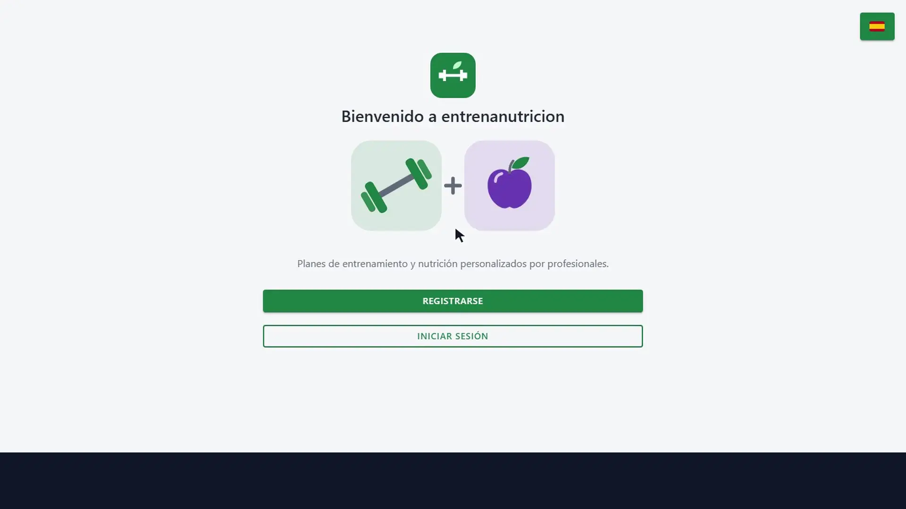

# entrenanutricion

Aplicación web progresiva (PWA, *mobile-first*) para gestionar entrenamientos y planes nutricionales
personalizados. Interfaz y catálogo (ejercicios, planes y alimentos) en **español, inglés y catalán**, con modo
claro y oscuro según el dispositivo. Los gráficos se adaptan a los dos modos y tienen una tabla equivalente para
los lectores de pantalla.

| Rol | Qué hace |
|---|---|
| **Cliente** | Se registra, rellena un formulario inicial (6 pasos) y espera sus planes. Con ambos planes sigue su plan semanal de entrenamiento con bloqueo secuencial: su inicio muestra en anillos el progreso del plan, las sesiones de la semana y su racha, y una tira con los días entrenados, previstos y sin hacer. Marca ejercicios, usa el cronómetro de descanso, elige sus días de entrenamiento, consulta sus macronutrientes y la biblioteca de alimentos, y anota las series (repeticiones y kilos). Su progreso reúne el calendario, el historial, el peso, sus récords, sus insignias y gráficos de las sesiones y los kilos levantados por semana y de los músculos más trabajados. Lleva un diario de comidas con anillos de calorías y macronutrientes frente a su plan y un gráfico de los últimos 7 días, ve el menú de ejemplo de su plan y su lista de la compra, escribe notas a su equipo y puede activar recordatorios por email. Confirma su email al registrarse y puede recuperar la contraseña. Puede instalar la app y seguir su entrenamiento sin conexión, descargar todos sus datos o eliminar su cuenta. |
| **Entrenador** | Gestiona ejercicios, entrenamientos y planes de entrenamiento y los asigna a los clientes pendientes. Sigue la adherencia de los clientes (un resumen por estados y tramos, y en la ficha de cada uno sus últimas cuatro semanas) y responde sus notas. |
| **Nutricionista** | Gestiona planes nutricionales (con su menú de ejemplo) y la biblioteca de alimentos, y asigna planes a los clientes pendientes. Ve el diario de comidas de los clientes. Sigue la adherencia de los clientes y responde sus notas. |
| **Administrador** | Todo lo anterior y la gestión de usuarios. Sus estadísticas comparan clientes, altas y sesiones con el mes anterior, y muestran los clientes por estado y por objetivo, las sesiones y altas de cada mes y los ejercicios y planes más populares. |

## Recorrido por la aplicación

Recorrido guiado de unos 14 minutos por los cuatro perfiles, con subtítulos y datos de demostración. Es un WebP
animado, así que no tiene sonido, y puede tardar en cargar (30 MB).



## Stack

- **Backend:** Python 3.12 · Django 5.2 · Django REST Framework · JWT (simplejwt con *blacklist*) ·
  drf-spectacular (OpenAPI) · PostgreSQL 16 · Google Cloud Storage (django-storages) · gunicorn + whitenoise.
- **Frontend:** Ionic 8 · React 18 · TypeScript · Vite · react-i18next · axios · Chart.js · React Hook Form + Zod.
- **Calidad:** pytest (cobertura ≥ 90 %, actualmente 99 %) · ruff + black · Vitest + Testing Library ·
  Playwright (E2E y auditoría de accesibilidad con axe-core) · ESLint + Prettier · GitHub Actions.

## Estructura

```
backend/    Django (config/ + apps/{core,accounts,training,nutrition,progress,notes,assignments,statistics}) y tests/
frontend/   Ionic React (src/{api,auth,offline,i18n,components,hooks,layouts,pages,validation,theme,utils}), e2e/ (Playwright)
docs/       Plan, progreso, decisiones, trazabilidad, API, arquitectura y operaciones
render.yaml Blueprint de Render · docker-compose.yml (desarrollo) · docker-compose.prod.yml (producción local)
```

## Puesta en marcha con Docker (desarrollo)

```bash
cp .env.example .env
docker compose up --build        # o: make up
```

El contenedor del backend aplica las migraciones y carga los datos de demostración (`SEED_DEMO=1`).

- App: http://localhost:5173
- API: http://localhost:8000/api/v1/ · OpenAPI (Swagger): http://localhost:8000/api/docs/
- Admin de Django: http://localhost:8000/admin/ (el admin y la documentación de la API están desactivados
  en producción)

### Usuarios de demostración

Contraseña de todos: `entrenanutricion#2025` (solo en desarrollo).

| Email | Rol / estado |
|---|---|
| `admin@entrenanutricion.dev` | Administrador |
| `trainer@entrenanutricion.dev` | Entrenador |
| `nutri@entrenanutricion.dev` | Nutricionista |
| `cliente@entrenanutricion.dev` | Cliente activo con ~3 meses de sesiones y pesos |
| `pendiente@entrenanutricion.dev` | Cliente pendiente de asignación |
| `nuevo@entrenanutricion.dev` | Cliente pendiente del formulario inicial |

`seed_demo` es idempotente y además crea 18 clientes repartidos en el año anterior y el actual, 25 ejercicios,
6 entrenamientos, 3 planes de entrenamiento, 6 planes nutricionales y 31 alimentos.

Otros comandos: `make seed`, `make test`, `make lint`, `make logs`, `make down`.

## Puesta en marcha sin Docker

Requisitos: Python 3.12, Node 24 y PostgreSQL 16 con una base `entrenanutricion`
(usuario y contraseña `entrenanutricion`, o ajusta `DATABASE_URL`).

```bash
# Backend
cd backend
python -m venv .venv && source .venv/bin/activate        # Windows: .venv\Scripts\activate
pip install --require-hashes -r requirements-dev.txt
python manage.py migrate
python manage.py seed_demo
python manage.py runserver

# Frontend (otra terminal)
cd frontend
npm ci
npm run dev                                              # http://localhost:5173 (proxy de /api y /media)
```

## Tests y calidad

```bash
# Backend
cd backend
pytest --cov                     # más de 1.100 tests, cobertura mínima 90 %
ruff check . && black --check .
python manage.py spectacular --validate --fail-on-warn --file /dev/null

# Frontend
cd frontend
npm test                         # Vitest
npm run lint && npm run format:check && npm run typecheck && npm run build
npx playwright install chromium
npm run e2e                      # Playwright: arranca o reutiliza backend (con seed_demo) y Vite
E2E_PREVIEW=1 npm run e2e        # lo mismo sobre el build de producción (CSP, service worker, sin conexión)
```

En Windows, `E2E_PYTHON='.venv\Scripts\python.exe' npm run e2e` indica a Playwright qué Python usar.

Los E2E se ejecutan con el perfil de un móvil (Pixel 7).

La CI (`.github/workflows/ci.yml`) se ejecuta en cada cambio de `main`, de las ramas de fase y de las PR. Pasa
lint, migraciones al día, *deploy checklist* de Django, validación del esquema OpenAPI, tests del backend con
PostgreSQL, tests y *build* del frontend, los E2E con datos demo sobre el *build* de producción y una prueba de
humo de las imágenes de producción. También audita las dependencias, comprueba la CSP, lanza una prueba de
carga corta y hace una restauración de prueba de la base de datos. Un *workflow* aparte (`uptime.yml`) vigila
la app desplegada cada 15 minutos.

La prueba de carga (`load/smoke.js`, k6) recorre las pantallas del cliente con 20 usuarios virtuales. Para
lanzarla contra el [stack de producción en local](#stack-de-producción-en-local), con los datos demo cargados y
su contraseña:

```bash
docker run --rm --network host -v "$PWD/load:/load" -e BASE_URL=http://localhost:8080 \
  -e DEMO_PASSWORD='<contraseña>' grafana/k6:2.2.0 run /load/smoke.js
```

Antes de abrir la app al público, sigue la lista de comprobación de
[`docs/OPERATIONS.md`](docs/OPERATIONS.md): monitorización, copias, seguridad y RGPD.

## Dependencias de Python

`requirements.in` (producción) y `requirements-dev.in` (desarrollo y CI) fijan las dependencias
directas. `requirements.txt` y `requirements-dev.txt` son el *lock*: todas las dependencias, también las
indirectas, con los *hashes* de sus ficheros. pip las instala con `--require-hashes` (Docker, Render y la
CI), así que un paquete alterado en el índice no llega a instalarse. Tras cambiar un `.in`, regenera los dos
*locks* con [uv](https://docs.astral.sh/uv/) desde `backend/`:

```bash
uv pip compile requirements.in --universal --python-version 3.12 --generate-hashes -o requirements.txt
uv pip compile requirements-dev.in --universal --python-version 3.12 --generate-hashes -o requirements-dev.txt
```

Haz lo mismo antes de aceptar una PR de Dependabot de Python: Dependabot rehace los *locks* solo para Linux
(ver `docs/DECISIONS.md`, D-86).

## Actualizaciones de dependencias

Dependabot (`.github/dependabot.yml`) propone cada semana las versiones nuevas del backend y del frontend, y
cada mes las de las acciones de GitHub y las imágenes Docker:

- solo versiones publicadas hace al menos dos semanas (las de seguridad, sin esperar);
- las menores de cada parte, agrupadas en una sola PR;
- se aceptan con la CI en verde.

No propone los saltos que necesitan un plan propio: Django 6, Ionic 9 con React 19 y react-router 6,
TypeScript 7 (hasta que lo admita `typescript-eslint`), PostgreSQL 17 o superior, las versiones nuevas de
Python y las mayores de Node (ver `docs/DECISIONS.md`, D-86).

## Stack de producción en local

```bash
# Una clave y una contraseña de la base de datos propias (en .env o en la shell): producción no
# arranca con una clave vacía, corta o publicada, y el compose no tiene contraseña por defecto.
export DJANGO_SECRET_KEY="$(python -c 'import secrets; print(secrets.token_urlsafe(50))')"
export POSTGRES_PASSWORD="$(python -c 'import secrets; print(secrets.token_hex(16))')"
docker compose -f docker-compose.prod.yml up --build      # http://localhost:8080
# Datos demo, con una contraseña propia (fuera de desarrollo no vale la del README):
docker compose -f docker-compose.prod.yml exec -e DEMO_PASSWORD='<contraseña>' backend \
  python manage.py seed_demo --allow-production
```

nginx sirve el *build* del frontend y hace de *proxy* de `/api` y `/media` hacia gunicorn. Es una réplica
para pruebas (HTTP sin TLS, media en un volumen local, emails en el log del contenedor con
`ALLOW_CONSOLE_EMAIL=1`); para un despliegue real usa Render + GCS.

## Despliegue en Render

El fichero `render.yaml` es un *Blueprint* que crea estos recursos:

| Recurso | Tipo | Detalle |
|---|---|---|
| `entrenanutricion-api` | Web service (Python) | `pip install` + `collectstatic` → `migrate` (*pre-deploy*) → gunicorn. *Health check* `/api/v1/health`. |
| `entrenanutricion-web` | Static site | `npm ci && npm run build`, publica `dist/`. *Rewrite* de `/api/*` a la API (mismo origen: la cookie de sesión es de primera parte) y de la SPA a `index.html`. Cabeceras de seguridad y CSP. |
| `entrenanutricion-backup` | Cron job (Docker) | Cada noche: `backup_database` (bucket privado con su propia cuenta de servicio; el bucket borra las copias a los 14 días) y `purge_inactive_accounts` (también borra las fotos de esas cuentas). |
| `entrenanutricion-reminders` | Cron job (Docker) | Cada hora: `send_training_reminders` (recordatorios de entreno por email). |
| `entrenanutricion-db` | PostgreSQL 16 | Solo accesible desde los servicios de Render. |
| `entrenanutricion-gcs` | Grupo de variables | La clave de la cuenta de servicio del bucket de ficheros (API y purga de cuentas). |
| `entrenanutricion-smtp` | Grupo de variables | El servidor SMTP de la API y de los recordatorios. |

Pasos:

1. Sube el repositorio a GitHub (o GitLab).
2. Prepara los dos buckets de Google Cloud Storage (siguiente apartado), uno para los ficheros y otro para
   las copias, con una cuenta de servicio para cada uno, y ten a mano los dos JSON. Ten también los datos
   de un servidor SMTP.
3. En Render: **New → Blueprint**, elige el repositorio y confirma los recursos de `render.yaml`.
4. Render pedirá los valores marcados como `sync: false`:
   - `GS_BUCKET_NAME` (API y *cron* de copias, el mismo valor) y `GS_BACKUP_BUCKET_NAME` (*cron* de
     copias): nombres de los buckets.
   - `GS_CREDENTIALS_JSON` (grupo `entrenanutricion-gcs`) y `GS_BACKUP_CREDENTIALS_JSON` (*cron* de
     copias): el JSON de la clave de cada cuenta de servicio **en una sola línea**.
   - `EMAIL_HOST`, `EMAIL_HOST_USER` y `EMAIL_HOST_PASSWORD` (grupo `entrenanutricion-smtp`).
   - `VITE_PRIVACY_CONTROLLER` y `VITE_PRIVACY_CONTACT` (*static site*): responsable del tratamiento y email
     de privacidad que muestra la política.
5. Si cambias el nombre del servicio API (o usas dominios propios), ajusta:
   - el destino del *rewrite* `/api/*` del *static site*;
   - `CORS_ALLOWED_ORIGINS` del API: `https://<web>.onrender.com`;
   - `ALLOWED_HOSTS` solo si usas dominios adicionales (el de Render se añade solo).
6. Despliega. El primer despliegue aplica las migraciones en el paso *pre-deploy* (requiere un plan de pago;
   en el plan gratuito, añade `python manage.py migrate --noinput &&` al principio del `startCommand`).
7. Crea el primer administrador desde la *Shell* del servicio API:
   `python manage.py createsuperuser` (se crea con rol `admin`).
8. Opcional, solo en entornos de demostración: añade `DEMO_PASSWORD` (una contraseña propia, no la del
   README) al servicio API y ejecuta `python manage.py seed_demo --allow-production`.
9. Los emails (confirmación del registro, recuperación de contraseña y recordatorios) salen por el SMTP del
   grupo `entrenanutricion-smtp` (puerto 587 con TLS; cámbialo allí si tu proveedor usa otro) con el
   remitente `DEFAULT_FROM_EMAIL`. `FRONTEND_URL` ya apunta al *static site*.

   Producción no arranca con un *backend* que no envía (consola, fichero…): los enlaces de recuperación
   quedarían en los logs. Solo en un entorno de pruebas sin SMTP: `EMAIL_BACKEND` de consola y
   `ALLOW_CONSOLE_EMAIL=1`.
10. Opcional pero recomendado:
    - Sentry: `SENTRY_DSN` en la API y `VITE_SENTRY_DSN` en el *static site*.
    - Disponibilidad: las variables del repositorio `HEALTHCHECK_URL` y `WEB_URL` (`docs/OPERATIONS.md`).

`DJANGO_SECRET_KEY` se genera automáticamente; producción no arranca con una clave vacía, corta (menos
de 32 caracteres), repetitiva o publicada en el repositorio. `JWT_SIGNING_KEY` (opcional) firma las
sesiones con una clave propia: cambiarla cierra todas las sesiones sin tocar la otra. En producción `DEBUG`
es `False`, se fuerza HTTPS
(`SECURE_SSL_REDIRECT`, HSTS de un año, cookies seguras) y se confía en la cabecera `X-Forwarded-Proto` del
*proxy* de Render.

### Google Cloud Storage (ficheros multimedia y copias)

1. En Google Cloud Console crea (o elige) un proyecto y activa la API **Cloud Storage**.
2. Crea un bucket:
   - ubicación cercana (p. ej. `europe-southwest1`);
   - **acceso uniforme** y **prevención de acceso público** activada (el bucket es privado).
3. Crea un segundo bucket igual para las copias de seguridad de la base de datos (contienen datos de salud),
   con:
   - una **regla de ciclo de vida** que borre los objetos de más de 14 días (`BACKUP_RETENTION_DAYS`);
   - una **política de retención** de 14 días, para que nadie pueda borrar una copia antes de tiempo
     (bloquéala con *Bucket Lock* cuando la hayas probado: después ya no se puede acortar).
4. Crea dos **cuentas de servicio** (IAM → Cuentas de servicio), cada una con permisos solo sobre su bucket:
   - ficheros: **Storage Object Admin** (`roles/storage.objectAdmin`) en el bucket de ficheros;
   - copias: **Storage Object Creator** (`roles/storage.objectCreator`) en el bucket de copias. Puede
     subir copias pero no leerlas ni borrarlas: quien obtenga la clave de la API no llega a ellas.
     Por eso el *cron* lleva `BACKUP_PRUNE=0` (borra el bucket, no el *job*).
5. En cada cuenta de servicio → **Claves → Añadir clave → JSON**. Descarga los ficheros.
6. Convierte cada JSON a una línea (p. ej. `jq -c . clave.json`) y pégalo en `GS_CREDENTIALS_JSON` (ficheros)
   y `GS_BACKUP_CREDENTIALS_JSON` (copias). Para restaurar o hacer un simulacro con una copia de GCS, usa
   una cuenta con permiso de lectura (`docs/OPERATIONS.md`).
7. `USE_GCS=1` (ya en `render.yaml`). Las respuestas de la API incluyen **URLs firmadas** que caducan a los
   `GS_EXPIRATION_MINUTES` (15 por defecto); al reemplazar o borrar un fichero se elimina el anterior.

No subas nunca la clave al repositorio (`gcs-credentials*.json` está en `.gitignore`).

## Variables de entorno

Todas están documentadas en [`.env.example`](.env.example). Las principales:

| Variable | Uso |
|---|---|
| `DJANGO_SECRET_KEY`, `JWT_SIGNING_KEY` | Clave secreta (obligatoria y robusta en producción) y, opcional, la de las sesiones |
| `DJANGO_SETTINGS_MODULE` | `config.settings.dev` / `config.settings.prod` |
| `DATABASE_URL` | Conexión a PostgreSQL |
| `ALLOWED_HOSTS`, `CORS_ALLOWED_ORIGINS`, `CSRF_TRUSTED_ORIGINS` | Dominios permitidos |
| `USE_GCS`, `GS_BUCKET_NAME`, `GS_CREDENTIALS_JSON`, `GS_EXPIRATION_MINUTES` | Almacenamiento en GCS |
| `THROTTLE_LOGIN`, `THROTTLE_LOGIN_ACCOUNT`, `THROTTLE_REGISTER`, `THROTTLE_PASSWORD`, `THROTTLE_EMAIL_EXISTS`, `THROTTLE_NOTES`, `THROTTLE_SESSION`, `THROTTLE_DATA_EXPORT`, `THROTTLE_UPLOADS` | Límites de peticiones |
| `DEFAULT_TRAINING_TIME`, `REMINDER_LEAD_MINUTES` | Hora de entreno de quien no ha elegido una (cuenta atrás y recordatorios) y antelación de los recordatorios |
| `EMAIL_VERIFICATION_MAX_AGE_DAYS`, `THROTTLE_EMAIL_VERIFICATION`, `THROTTLE_EMAIL_VERIFICATION_RESEND` | Caducidad del enlace de confirmación del email y límites de peticiones |
| `EMAIL_BACKEND`, `EMAIL_HOST`, `EMAIL_PORT`, `EMAIL_HOST_USER`, `EMAIL_HOST_PASSWORD`, `EMAIL_USE_TLS`, `DEFAULT_FROM_EMAIL`, `ALLOW_CONSOLE_EMAIL` | Envío de emails. En desarrollo, a la consola; en producción, SMTP (la consola solo con `ALLOW_CONSOLE_EMAIL=1`) |
| `FRONTEND_URL`, `PASSWORD_RESET_TIMEOUT_MINUTES`, `THROTTLE_PASSWORD_RESET` | Enlace de recuperación (URL pública de la app), caducidad y límite de peticiones |
| `NUM_PROXIES` | *Proxies* delante de Django (1 en Render y en el nginx local) para identificar al cliente en los límites de peticiones |
| `AUTH_COOKIE_SECURE`, `AUTH_COOKIE_SAMESITE` | Cookie del *refresh token* (por defecto `Secure` y `Lax`) |
| `GS_BACKUP_BUCKET_NAME`, `GS_BACKUP_CREDENTIALS_JSON`, `BACKUP_DIR`, `BACKUP_RETENTION_DAYS`, `BACKUP_PRUNE`, `PG_BIN_DIR` | Copias de seguridad |
| `DEMO_PASSWORD` | Contraseña de las cuentas demo fuera de desarrollo (`seed_demo --allow-production`) |
| `SENTRY_DSN`, `SENTRY_ENVIRONMENT`, `SENTRY_TRACES_SAMPLE_RATE` | Monitorización de errores (vacío = desactivada) |
| `PRIVACY_POLICY_VERSION`, `ACCOUNT_RETENTION_DAYS` | Versión vigente de la política de privacidad y plazo de purga de las cuentas dadas de baja |
| `VITE_API_URL` | URL de la API vista desde el navegador (build del frontend) |
| `VITE_SENTRY_DSN`, `VITE_PRIVACY_CONTROLLER`, `VITE_PRIVACY_CONTACT`, `VITE_PRIVACY_POLICY_VERSION` | Monitorización y datos de la política de privacidad (build del frontend) |

## Documentación

- [`docs/ARCHITECTURE.md`](docs/ARCHITECTURE.md): arquitectura, modelo de datos y navegación (Mermaid).
- [`docs/API.md`](docs/API.md): convenciones y resumen de la API (detalle completo en `/api/docs/`, en
  desarrollo).
- [`docs/OPERATIONS.md`](docs/OPERATIONS.md): puesta en producción, monitorización, copias, seguridad y RGPD.
- [`docs/DECISIONS.md`](docs/DECISIONS.md): decisiones de diseño.
- [`docs/TRACEABILITY.md`](docs/TRACEABILITY.md): historias de usuario ↔ endpoints ↔ pantallas ↔ tests.
- [`docs/PLAN.md`](docs/PLAN.md): plan de implementación por fases.
- [`docs/PROGRESS.md`](docs/PROGRESS.md): estado por fase y *Definition of Done*.

