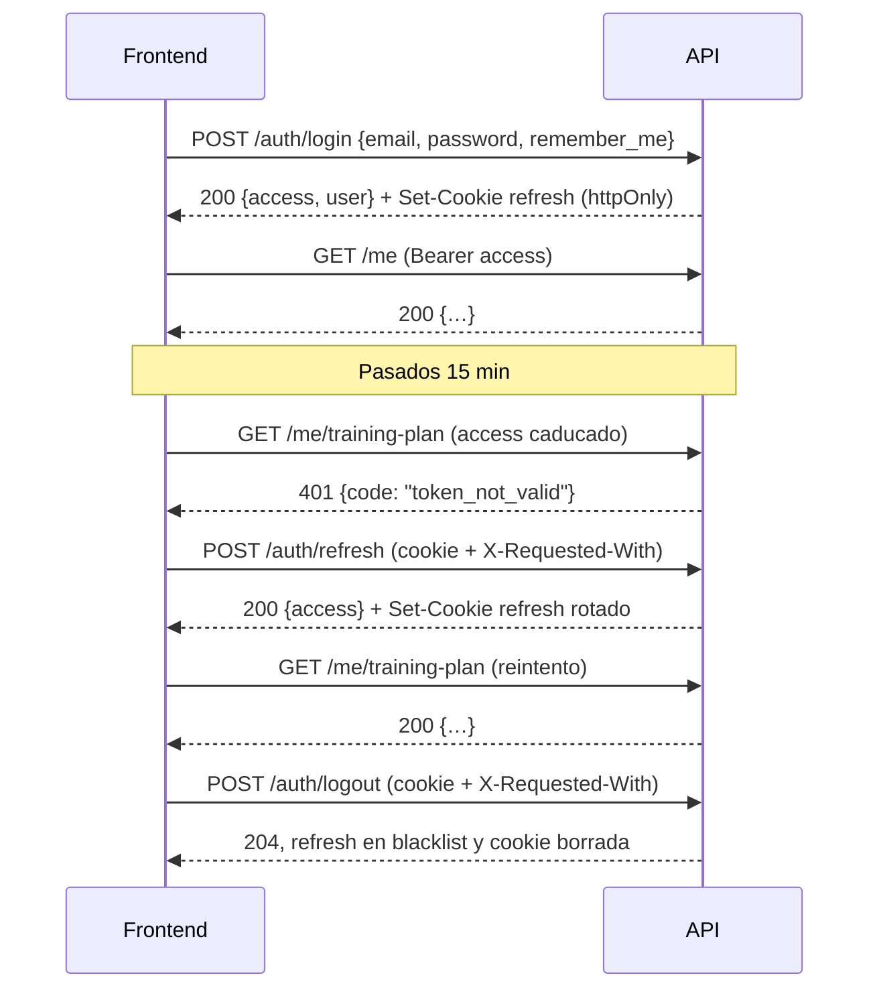

# API de entrenanutricion

API REST JSON en `/api/v1/` (Django REST Framework). La referencia completa, con esquemas de petición y
respuesta, es el documento **OpenAPI 3** que genera drf-spectacular:

| Recurso | URL |
|---|---|
| Swagger UI | `/api/docs/` |
| Esquema OpenAPI (YAML/JSON) | `/api/schema/` |

En desarrollo: http://localhost:8000/api/docs/. En producción las dos URLs están desactivadas
(`API_DOCS_PUBLIC`, D-80). La CI valida el esquema con `manage.py spectacular --validate --fail-on-warn`.

Este documento resume las convenciones y los endpoints; ante cualquier discrepancia manda el esquema OpenAPI.

## Convenciones

- **JSON en `snake_case`.** El frontend lo convierte a `camelCase` en `src/api/case.ts`.
- **Sin barra final** en las rutas: `/api/v1/exercises/5`, no `/exercises/5/`.
- **Fechas** en ISO 8601: `YYYY-MM-DD` y *datetimes* con zona horaria.
- **Ficheros:** se envían con `multipart/form-data`. Las URLs de los ficheros son absolutas; con GCS son
  URLs firmadas que caducan.
- **Paginación** *limit/offset*: `?limit=20&offset=40`, con 20 por defecto y 100 como máximo.
  ```json
  { "count": 57, "next": "…?limit=20&offset=40", "previous": "…?limit=20&offset=0", "results": [ … ] }
  ```
- **Búsqueda y orden:** `?search=texto` y `?ordering=campo` o `?ordering=-campo` (los campos admitidos
  están en OpenAPI). Los filtros específicos de cada listado están en la tabla de endpoints.
- **Catálogo e inactivos:** los listados del catálogo ocultan los elementos desactivados. Para incluirlos,
  el personal añade `?include_inactive=true`.
- **Caché:** todas las respuestas llevan `Cache-Control: no-store`.

## Autenticación

JWT con [simplejwt](https://django-rest-framework-simplejwt.readthedocs.io/). El *access token* va en la
cabecera `Authorization: Bearer <access>`. El *refresh token* va en una **cookie httpOnly**: JavaScript no lo ve
y nunca aparece en el cuerpo de una respuesta.

| Token | Dónde | Duración | Notas |
|---|---|---|---|
| `access` | Memoria del frontend y cabecera `Authorization` | 15 min | Va en cada petición. |
| `refresh` | Cookie `entrenanutricion_refresh` (`HttpOnly`, `Secure`, `SameSite=Lax`, `Path=/api/v1/auth/`) | 12 h, o 7 días con `remember_me: true` | Sin «recordar», la cookie es de sesión del navegador. Rota en cada refresco y el anterior pasa a la *blacklist*; la marca «recordar» se conserva. |

`POST /auth/refresh` y `POST /auth/logout` leen la cookie y exigen la cabecera
`X-Requested-With: entrenanutricion` (`403 csrf_failed` sin ella). Un `refresh` en el cuerpo se ignora.



- **Registro y login.**
  - `POST /auth/register` crea siempre un **cliente** en estado `pending_onboarding`.
  - El registro pide `terms_accepted` y, por separado, `health_data_consent` (consentimiento expreso para los
    datos de salud).
  - Tanto el registro como `POST /auth/login` responden `{access, user}` y fijan la cookie. `user` es el
    mismo objeto que `GET /me`.
- **Sin sesión.** `POST /auth/refresh` responde `401` (`not_authenticated` si no hay cookie,
  `token_not_valid` si caducó o está en la *blacklist*). El *logout* responde siempre `204`.
- **Credenciales incorrectas.** El login responde `401` con `code: "invalid_credentials"`, sin revelar si el
  email existe.
- **Contraseñas.** Además de la longitud y los tipos de caracteres, se rechazan las más comunes
  (`password_too_common`) y las parecidas al nombre o al email (`password_too_similar`). Como máximo, 128
  caracteres (`max_length`).
- **Refresco concurrente.** El cliente HTTP del frontend hace un único refresco aunque varias peticiones
  reciban 401 a la vez (*single flight*) y después las reintenta.
- **Cambio de contraseña.** `PUT /me/password` invalida todos los *refresh tokens* y los *access tokens* ya
  emitidos del usuario (`401 token_not_valid`), devuelve `{access}` y fija una cookie nueva, que conserva
  «recordar sesión».
- **Recuperación de contraseña.**
  - `POST /auth/password-reset {email}` responde siempre `204`, exista o no la cuenta.
  - Si la cuenta existe, envía un enlace de un solo uso que caduca (60 min por defecto) a
    `FRONTEND_URL/reset-password?uid=…&token=…`, en el idioma de `Accept-Language`.
  - `POST /auth/password-reset/confirm {uid, token, new_password, confirm_password}` cambia la contraseña y
    cierra todas las sesiones, también los *access tokens* ya emitidos.
- **Límites de peticiones** (`429`, con `Retry-After`). Configurables por variable de entorno:
  - login: 10/min por IP, y 10 fallos por hora por cuenta e IP, con 50 en total por cuenta (un acierto o una
    contraseña nueva los ponen a cero)
  - registro: 10/min por IP
  - cambio de contraseña: 5/min por usuario
  - `email-exists`: 10/min por IP
  - recuperación de contraseña: 5/min por IP
  - peticiones con ficheros: 100/hora por usuario
  - renovación y cierre de sesión: 120/min por IP
  - descarga de datos: 5/hora por usuario

## Errores

Todas las respuestas de error usan el mismo formato:

```json
{
  "code": "validation_error",
  "message": "Some fields are not valid.",
  "fields": { "meal_distribution.0.percentage": ["Ensure this value is less than or equal to 100."] },
  "field_codes": { "meal_distribution.0.percentage": ["max_value"] }
}
```

| Campo | Contenido |
|---|---|
| `code` | Código estable. El frontend **traduce por `code`** (`errors.<code>` en los JSON de i18n), nunca por `message`. |
| `message` | Texto en inglés, solo para depuración. |
| `fields` | Solo en errores de validación. Las claves de objetos o listas anidadas usan puntos (`items.2.reps`). |
| `field_codes` | Igual que `fields`, pero con los códigos de error de cada campo. |

| Estado | Cuándo | Códigos habituales |
|---|---|---|
| 400 | Validación o regla de negocio | `validation_error`, `required`, `email_taken`, `invalid_choice`, `too_young`, `too_old`, `distribution_sum`, `calories_mismatch`, `invalid_file_type`, `file_too_large`, `image_too_large`, `too_many_media`, `plan_inactive`, `exercise_inactive`, `token_not_valid`, `reset_link_invalid`, `duplicated_choice`, `food_name_taken`, `macros_exceed_100g`, `sugars_exceed_carbs`, `saturated_exceed_fats`, `health_consent_required`, `privacy_required`, `password_too_common`, `password_too_similar`, `date_too_old` |
| 401 | Sin sesión o con un token inválido o caducado | `not_authenticated`, `token_not_valid`, `invalid_credentials` |
| 403 | El rol no tiene permiso, el entrenamiento aún está bloqueado o falta la cabecera de la app | `permission_denied`, `clients_only`, `workout_locked`, `csrf_failed`, `staff_account_managed` |
| 404 | No existe, o es un recurso de otro cliente (para no revelar que existe) | `not_found`, `onboarding_not_completed` |
| 409 | Conflicto con el estado actual | `cannot_delete_self`, `cannot_change_own_role`, `onboarding_already_completed`, `onboarding_not_completed`, `training_plan_not_assigned`, `nutrition_plan_not_assigned`, `training_plan_already_assigned`, `nutrition_plan_already_assigned`, `workout_in_use`, `workout_already_completed`, `workout_not_finished`, `food_log_day_full` |
| 413 | La petición supera el tamaño máximo (el vídeo más grande permitido más 1 MB) | `request_too_large` |
| 429 | Límite de peticiones | `throttled` |
| 500 | Error no controlado (se registra en el log) | `server_error` |

## Roles y permisos

- **Los permisos se comprueban siempre en el backend** (`apps/core/permissions.py`).
- **Personal (*staff*):** entrenador, nutricionista y administrador.
- **Cliente:** solo ve sus propios datos, a través de `/me/…`. Si pide un recurso de otro usuario recibe
  `404`.

| Grupo de endpoints | Anónimo | Cliente | Entrenador | Nutricionista | Admin |
|---|---|---|---|---|---|
| `auth/*`, `health` | ✅ | ✅ | ✅ | ✅ | ✅ |
| `me`, `me/profile`, `me/password`, `me/photo`, `me/consent`, `me/export` | — | ✅ | ✅ | ✅ | ✅ |
| `me/account` (eliminar la cuenta) | — | ✅ | — | — | — |
| `auth/password-reset`, `auth/password-reset/confirm` | ✅ | ✅ | ✅ | ✅ | ✅ |
| `me/onboarding`, `me/training-plan…`, `me/training-days`, `me/exercises/{id}`, `me/nutrition-plan`, `me/progress/*`, `me/weight-records`, `me/badges` | — | ✅ | — | — | — |
| `muscle-groups` (lectura) | — | — | ✅ | ✅ | ✅ |
| `exercises`, `workouts`, `training-plans` | — | — | ✅ lectura/escritura | lectura | ✅ |
| `meal-plans` | — | — | lectura | ✅ lectura/escritura | ✅ |
| `foods` (biblioteca de alimentos) | — | lectura | lectura | ✅ lectura/escritura | ✅ |
| `users` | — | — | lectura (solo clientes) | lectura (solo clientes) | ✅ lectura/escritura |
| `assignments/pending` | — | — | ✅ | ✅ | ✅ |
| `users/{id}/assign-training-plan` | — | — | ✅ | — | ✅ |
| `users/{id}/assign-nutrition-plan` | — | — | — | ✅ | ✅ |
| `statistics/*` | — | — | — | — | ✅ |

`backend/tests/test_permissions.py` comprueba esta matriz para los 5 perfiles.

## Endpoints

Todas las rutas cuelgan de `/api/v1`. Entre paréntesis, los filtros propios de cada listado (además de
`search`, `ordering`, `limit` y `offset`).

### Idioma del contenido

El catálogo (ejercicios con sus pasos, entrenamientos, planes de entrenamiento y nutricionales y alimentos)
se devuelve en el idioma de la cabecera `Accept-Language` (`es`, `en` o `ca`), y en español cuando falta la
traducción. Los *endpoints* de gestión del catálogo incluyen además `translations`, con los tres idiomas
(`{"es": {...}, "en": {...}, "ca": {...}}`). Al escribir se envían `en` y `ca`; los textos vacíos se quitan.
Los pasos de un ejercicio se traducen como lista (`"steps": [...]`).

### Salud y autenticación

| Método | Ruta | Descripción |
|---|---|---|
| GET | `/health` | Comprobación de vida (base de datos incluida). La usan Render y Docker. |
| POST | `/auth/register` | Alta de cliente: nombre, apellidos, email, contraseña, fecha de nacimiento (18 a 120 años), género y aceptación de términos. |
| POST | `/auth/login` | Inicio de sesión (`remember_me` opcional). |
| POST | `/auth/refresh` | Nuevo `access` y `refresh` rotado. |
| POST | `/auth/logout` | Invalida el `refresh` (*blacklist*). |
| GET | `/auth/email-exists?email=` | `{exists: bool}`, para validar el registro en vivo. |
| POST | `/auth/password-reset` | Pide el enlace de recuperación por email (siempre `204`). Como mucho un email cada 2 minutos por dirección. |
| POST | `/auth/password-reset/confirm` | Nueva contraseña con el `uid` y el `token` del enlace. `400 reset_link_invalid` si el enlace no vale, caducó o ya se usó. También confirma el email. |
| POST | `/auth/verify-email` | `{token}` del email de confirmación que se envía al registrarse (vale 7 días): `{email_verified: true}`. `400 verification_link_invalid` o `verification_link_expired`. |

### Usuario actual

| Método | Ruta | Descripción |
|---|---|---|
| GET | `/me` | Perfil, rol y estado, más indicadores de formulario inicial completado, de planes asignados y de email confirmado (`email_verified`), e idioma de la cuenta (`language`). |
| PATCH | `/me/profile` | Nombre, apellidos, fecha de nacimiento, género e idioma (`language`: `es`, `en` o `ca`, el de los emails). |
| POST | `/me/verify-email/resend` | Reenvía el enlace de confirmación (`202`; 3 por hora). `409 email_already_verified` si ya está confirmado. |
| PUT | `/me/password` | Cambio de contraseña (requiere la actual). |
| PUT / DELETE | `/me/photo` | Sube o elimina la foto de perfil (JPEG/PNG/WebP, máx. 5 MB). |
| POST | `/me/consent` | `{privacy_policy, health_data}`: acepta la versión vigente de la política de privacidad (y, los clientes, el uso de los datos de salud). `GET /me` indica `consent_required` mientras falte. |
| GET | `/me/export` | Todos los datos personales en un JSON descargable (derechos de acceso y portabilidad), con los accesos del equipo a sus datos de salud (`health_data_accesses`). |
| DELETE | `/me/account` | `{password}`: el cliente elimina su cuenta y todos sus datos (derecho de supresión). El personal: `403 staff_account_managed`. |
| GET / POST / PUT | `/me/onboarding` | Formulario inicial: datos físicos, objetivos, entrenamiento, dieta y salud. El `POST` pasa al cliente a `pending_assignment`. |

### Cliente: entrenamiento, nutrición y progreso

| Método | Ruta | Descripción |
|---|---|---|
| GET | `/me/training-plan` | Plan actual: secuencia de entrenamientos con su estado (bloqueado, disponible o completado) y fecha prevista, progreso, ciclo y días de entrenamiento (`training_days`, `custom_training_days`). |
| GET / PUT | `/me/training-days` | Días de la semana en que entrena el cliente (`{days: [0..6]}`, lunes = 0, máximo 6). El número de días pasa a ser los días semanales; `[]` vuelve al reparto recomendado. |
| GET | `/me/training-plan/workouts/{id}` | Detalle de un entrenamiento del plan, con sus ejercicios y su estado. Cada ejercicio incluye `logged_sets` (series anotadas) y `last_sets` (las de su última sesión). `403 workout_locked` si aún no toca. |
| PUT | `/me/training-plan/workouts/{id}/exercises/{item_id}` | Marca o desmarca un ejercicio como hecho (`{completed, sets?}`). `sets`: `[{reps, weight_kg}]`, hasta 20 (0–200 repeticiones, 0–500 kg con un decimal); si no se envía, se conservan las ya anotadas. |
| POST | `/me/training-plan/workouts/{id}/complete` | Completa el entrenamiento: crea la sesión, los registros de ejercicios y sus series (las planificadas si no se anotaron) y desbloquea el siguiente. Al completar el último, empieza un nuevo ciclo. Incluye `new_badges` y `new_records` (series que baten la carga máxima anterior). |
| GET | `/me/records` | Récords por ejercicio con carga: serie más pesada (kilos, repeticiones y fecha) y 1RM estimado (Epley). |
| GET | `/me/exercises/{id}/history` | Récord del ejercicio y sus últimas 30 sesiones, con las series, la carga máxima y el volumen. |
| GET / PUT | `/me/reminders` | Hora de entreno (`training_time` `HH:MM`; `null` vuelve a `DEFAULT_TRAINING_TIME`) y recordatorios por email (`enabled`). |
| GET / POST | `/me/notes` | Hilo de notas con el equipo (paginado, de la más reciente a la más antigua) y nueva nota (`{body}`, hasta 2000 caracteres; 30 por minuto). |
| GET | `/me/notes/unread` | `{unread}`: notas del equipo sin leer. |
| POST | `/me/notes/read` | Marca como leídas las notas del equipo. |
| GET | `/me/exercises/{id}` | Ficha de un ejercicio del plan del cliente: técnica, pasos, errores, beneficios y multimedia. |
| GET | `/me/nutrition-plan` | Plan nutricional actual: calorías, macros y reparto por comidas. |
| GET | `/me/nutrition-plan/menu` | Menú de ejemplo del plan: por comida, los alimentos con sus gramos y valores, y los totales frente a los objetivos. |
| GET | `/me/shopping-list?days=` | Alimentos del menú para 1–14 días (7 por defecto), con los gramos totales, por categoría y nombre. |
| GET / POST | `/me/food-log` (`date`) | Diario de un día (hoy por defecto) y nueva anotación (`{date, meal, food_id, grams}`, sin fechas futuras ni de hace más de 5 años (`date_too_old`), 1–2000 g). Los valores de la ración se copian al anotarla. Devuelve el día con sus totales y los objetivos del plan. |
| PATCH / DELETE | `/me/food-log/{id}` | Cambia los gramos o la comida de una anotación, o la borra. Devuelve el día. |
| POST | `/me/food-log/copy-menu` | `{date, meal?}`: anota el menú de una comida o del día entero. `409 menu_empty` si no hay menú. Un día admite 60 anotaciones (`409 food_log_day_full`, con `max`); la copia añade todas o ninguna. |
| GET | `/me/food-log/summary?days=` | Totales de los últimos 1–31 días (7 por defecto), días anotados, media y objetivo de calorías. |
| GET | `/me/progress/dashboard?month=YYYY-MM` | Días entrenados y previstos del mes, próximo entrenamiento (con hora objetivo), progreso del plan, sesiones totales y mensajes de motivación (claves i18n con parámetros). También `week`, esta semana de lunes a domingo (`scheduled`, `completed`), y `streak_weeks`, las semanas seguidas del plan actual con todas las sesiones previstas hechas: la semana en curso cuenta cuando se completa. |
| GET | `/me/progress/history` (`date_from`, `date_to`, `workout`) | Historial paginado de sesiones. |
| GET | `/me/progress/stats` | Las últimas 12 semanas, de lunes a domingo y de la más antigua a la actual: sesiones, minutos y kilos levantados (repeticiones × kilos de las series con carga). También las series de cada grupo muscular en los últimos 28 días, de más a menos. |
| GET / POST | `/me/weight-records` | Serie de pesos y alta de un peso (como máximo uno por día; si ya hay uno, lo sustituye; de los últimos 5 años, `date_too_old` si no). El alta devuelve también `new_badges`. |
| GET | `/me/badges` | Las 8 insignias con `earned`, `awarded_at` y progreso (`current`/`target`); concede las pendientes. |

### Catálogo de entrenamiento (personal)

| Método | Ruta | Descripción |
|---|---|---|
| GET | `/muscle-groups` | Grupos musculares (fijos, creados por migración). |
| GET / POST | `/exercises` (`muscle_group`, `include_inactive`) | Listado y alta de ejercicios con pasos ordenados. |
| GET / PUT / PATCH / DELETE | `/exercises/{id}` | Detalle, edición y borrado. Si el ejercicio está en uso se desactiva (*soft delete*); si no, se borra. |
| POST | `/exercises/{id}/media` | Añade una imagen o un vídeo (hasta 10 por ejercicio; imagen 5 MB, vídeo 50 MB). |
| DELETE | `/exercises/{id}/media/{media_id}` | Elimina un fichero multimedia. |
| GET / POST | `/workouts` | Entrenamientos con ejercicios ordenados (series, repeticiones, descanso). |
| GET / PUT / PATCH / DELETE | `/workouts/{id}` | `409 workout_in_use` si se intenta borrar un entrenamiento usado en un plan. |
| PUT / DELETE | `/workouts/{id}/media` | Imagen o vídeo del entrenamiento. |
| GET / POST | `/training-plans` (`goal`, `difficulty`, `equipment`, `include_inactive`) | Planes con su secuencia de entrenamientos. |
| GET / PUT / PATCH / DELETE | `/training-plans/{id}` | Si el plan está asignado se desactiva; si no, se borra. Editar la secuencia sincroniza a los clientes que lo tienen asignado. |
| PUT / DELETE | `/training-plans/{id}/media` | Imagen o vídeo del plan. |

### Planes nutricionales (personal)

| Método | Ruta | Descripción |
|---|---|---|
| GET / POST | `/meal-plans` (`category`, `diet_label`, `include_inactive`) | Plan con calorías y macros; las calorías deben cuadrar con los macros y los porcentajes del reparto por comidas deben sumar 100. |
| GET / PUT / PATCH / DELETE | `/meal-plans/{id}` | El borrado siempre es lógico (se desactiva): los clientes que lo tienen lo conservan. |
| GET / PUT | `/meal-plans/{id}/menu` | Menú de ejemplo de un día. El `PUT` (nutricionista o admin) lo sustituye entero: `{items: [{meal, food_id, grams}]}`, hasta 60. La respuesta incluye los totales por comida y del día, la desviación de calorías (`calories_deviation_pct`) y si queda a ±10 % (`within_tolerance`). |

### Biblioteca de alimentos

| Método | Ruta | Descripción |
|---|---|---|
| GET | `/foods` (`category`, `search`, `ordering`) | Alimentos con kcal, macros, fibra, azúcares, grasas saturadas y micronutrientes **por 100 g** (los opcionales pueden ser `null`). Incluye `macros` con gramos, kcal y % como los planes nutricionales. |
| POST | `/foods` | Alta (nutricionista o admin). Macros ≤ 100 g, azúcares ≤ carbohidratos, saturadas ≤ grasas y nombre único. |
| GET / PUT / PATCH / DELETE | `/foods/{id}` | Detalle, edición y borrado definitivo, salvo si el alimento está en algún menú: `409 food_in_use` (con `plans`). El diario conserva su copia de los valores. |

### Usuarios y asignaciones

| Método | Ruta | Descripción |
|---|---|---|
| GET | `/users` (`role`) | Listado de usuarios. Entrenadores y nutricionistas solo reciben clientes. |
| POST | `/users` | Alta de usuarios de cualquier rol (solo admin). |
| GET / PUT / PATCH / DELETE | `/users/{id}` | Detalle con los datos del formulario inicial; edición y baja lógica, que desactiva la cuenta y cierra sus sesiones (solo admin; no puede darse de baja a sí mismo ni cambiar su propio rol). Entrenadores y nutricionistas reciben `404` si no es un cliente. Mostrar a un profesional los datos de salud de un cliente queda registrado. |
| GET | `/users/{id}/health-data-accesses` | Solo admin: quién del equipo vio los datos de salud del cliente y cuándo, del más reciente al más antiguo (`staff`, `staff_name`, `staff_role`, `accessed_at`; nunca los valores). Paginado. Como mucho una fila por profesional, cliente y hora; también cuentan `/users/{id}/notes` y `/users/{id}/food-log/summary`. |
| GET | `/assignments/pending` | Clientes con el formulario inicial completado a los que les falta un plan: al entrenador, el de entrenamiento; al nutricionista, el nutricional; al admin, cualquiera de los dos. |
| POST | `/users/{id}/assign-training-plan` | `{plan_id, replace}`: asigna el plan de entrenamiento. Si ya tiene uno responde `409 training_plan_already_assigned` (con `current_plan`); con `replace: true` lo sustituye y el anterior deja de ser el actual. |
| POST | `/users/{id}/assign-nutrition-plan` | `{plan_id, replace}`: igual para el plan nutricional (`409 nutrition_plan_already_assigned`). |
| GET | `/adherence` (`status`, `search`) | Clientes con plan, del que más ayuda necesita al que menos (`inactive`, `at_risk`, `on_track`). Para cada uno: días entrenados frente a programados en 28 días, último entreno y variación de peso (registra el acceso a los datos de salud de los clientes de la página que lo muestran, D-91). Incluye `counts` por estado, `distribution` (clientes por tramos de 20 puntos: `low`, `high`, `count`) y `average_percent`, la media; los tres describen a todos los clientes, sin el filtro de estado, y los que aún no tienen nada programado no cuentan en los dos últimos. |
| GET | `/users/{id}/adherence` | La adherencia de un cliente con las últimas cuatro semanas (`weeks`); registra el acceso si muestra su peso. `409 training_plan_not_assigned` si no tiene plan. |
| GET / POST | `/users/{id}/notes` | Hilo de notas de un cliente y respuesta del profesional. |
| POST | `/users/{id}/notes/read` | Marca como leídas las notas del cliente (para todo el equipo). |
| GET | `/notes/inbox` | Clientes con notas sin leer por el equipo, con el número y la última nota. |
| GET | `/users/{id}/food-log/summary?days=` | Resumen del diario de comidas de un cliente (como `/me/food-log/summary`). |

El estado del cliente lo recalcula siempre `apps.assignments.services.recompute_user_status`:

- `pending_onboarding` hasta que envía el formulario inicial.
- `pending_assignment` mientras le falte algún plan.
- `active` cuando tiene ambos planes.
- `inactive` tras la baja lógica.

### Estadísticas (admin)

| Método | Ruta | Descripción |
|---|---|---|
| GET | `/statistics/summary` | KPIs: usuarios por rol, clientes activos y pendientes, sesiones. También la comparación con los mismos días del mes anterior (`sessions_previous_period`, `new_clients_this_month`, `new_clients_previous_period`; las altas cuentan las cuentas cerradas después) y los clientes activos por objetivo (`clients_by_goal`). |
| GET | `/statistics/years` | Años con datos (para los selectores). |
| GET | `/statistics/exercise-popularity?year=&limit=` | Ejercicios más realizados del año. |
| GET | `/statistics/platform-growth?year=` | Altas de clientes por mes del año. |
| GET | `/statistics/sessions?year=` | Entrenamientos completados por mes del año (12 meses). |
| GET | `/statistics/plan-popularity?limit=` | Planes de entrenamiento y nutricionales con más clientes ahora (asignaciones vigentes de cuentas activas), de más a menos. |

## Ejemplo

```bash
API=http://localhost:8000/api/v1
TOKEN=$(curl -s -X POST $API/auth/login -H 'Content-Type: application/json' \
  -d '{"email":"cliente@entrenanutricion.dev","password":"entrenanutricion#2025"}' | jq -r .access)

curl -s $API/me/training-plan -H "Authorization: Bearer $TOKEN" | jq '.plan.name, .progress'
```
