# Arquitectura de entrenanutricion

Resumen técnico del sistema, pensado para quien vaya a mantenerlo. Los diagramas están en Mermaid (GitHub
y la mayoría de los editores los muestran directamente). Las decisiones que justifican cada elección están en
[`DECISIONS.md`](DECISIONS.md) y la API en [`API.md`](API.md).

## 1. Vista general

Una SPA instalable (PWA) habla por HTTPS con una API REST sin estado. La sesión se mantiene con JWT; no hay
cookies de sesión ni CSRF en la API.

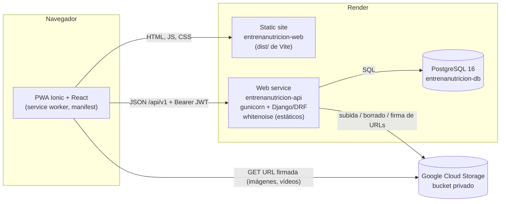

| Entorno | Frontend | API | Base de datos | Ficheros |
|---|---|---|---|---|
| Desarrollo (`docker-compose.yml` o local) | Vite en `:5173`, con *proxy* de `/api` y `/media` | `runserver` en `:8000` | PostgreSQL 16 | Disco local (`backend/media/`) |
| Producción local (`docker-compose.prod.yml`) | nginx en `:8080`, con *proxy* de `/api` y `/media` | gunicorn | PostgreSQL 16 | Volumen Docker (`SERVE_MEDIA=1`) |
| Render (`render.yaml`) | *Static site* en su propio dominio | gunicorn en su propio dominio (CORS) | Render PostgreSQL | GCS con URLs firmadas |

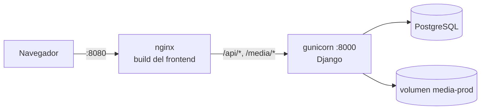

## 2. Backend

### Capas

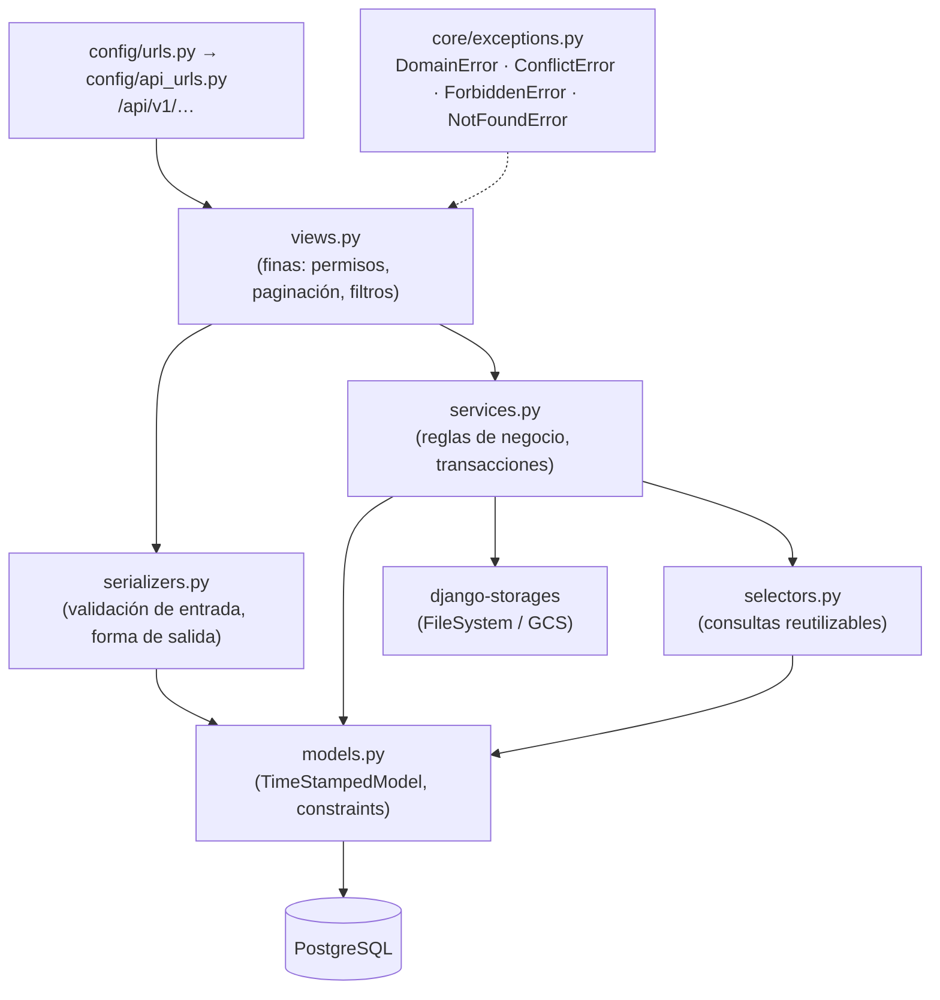

- **Vistas finas.**
  - Una vista comprueba permisos (`apps/core/permissions.py`), valida con un *serializer* y delega en un
    servicio.
  - Los errores de negocio se lanzan como excepciones con un `code` estable.
  - `api_exception_handler` los convierte al formato `{code, message, fields, field_codes}`.
- **Servicios.**
  - Toda regla que toca varias tablas vive en `services.py` y se ejecuta dentro de `transaction.atomic`.
  - Por ejemplo: asignar planes, completar entrenamientos, sincronizar un plan editado o dar de baja usuarios.
- **Fuente única del estado del usuario.** `apps.assignments.services.recompute_user_status` se llama tras
  cualquier cambio que afecte al estado: formulario inicial, asignación o baja.
- **Rendimiento.**
  - Los listados usan `select_related`/`prefetch_related` y anotaciones.
  - Los endpoints clave tienen un test con número máximo de consultas.
- **Ficheros.**
  - `apps/core/files.py` valida el tipo real (Pillow para imágenes, cabeceras para vídeo) y el tamaño.
  - Los ficheros se guardan con nombre UUID.
  - Al reemplazar o borrar un fichero, unas señales eliminan el anterior del almacenamiento.

### Aplicaciones

| App | Responsabilidad |
|---|---|
| `core` | `TimeStampedModel`, permisos por rol, errores, paginación, validación de ficheros, *logging*, `seed_demo` |
| `accounts` | `User` (login por email, rol, estado, idioma), formulario inicial (`UserDetails`, `DietPreferences`, `HealthInfo`), auth JWT (fin de la sesión al cambiar la contraseña), verificación del email, `/me`, `/users`, registro de accesos a los datos de salud (`HealthDataAccess`) |
| `training` | Catálogo (grupos musculares, ejercicios, entrenamientos, planes), asignación de planes, secuencia bloqueada por usuario, sesiones, series y récords, calendario y recordatorios |
| `nutrition` | Catálogo de planes nutricionales con su menú de ejemplo, plan asignado, biblioteca de alimentos, lista de la compra y diario de comidas |
| `progress` | Peso, panel de progreso, historial, estadísticas de entrenamiento, mensajes de motivación, insignias y adherencia (personal) |
| `notes` | Notas asíncronas entre cada cliente y el equipo |
| `assignments` | Clientes pendientes, asignación de planes y cálculo del estado |
| `statistics` | KPIs, popularidad de ejercicios y crecimiento de la plataforma |

### Modelo de datos

Todos los modelos heredan `created_at` y `updated_at` de `TimeStampedModel`.

```mermaid
erDiagram
    USER ||--o| USER_DETAILS : "formulario inicial"
    USER ||--o| DIET_PREFERENCES : ""
    USER ||--o| HEALTH_INFO : ""
    USER ||--o{ WEIGHT_RECORD : "registra"
    USER ||--o{ USER_TRAINING_PLAN : "tiene"
    USER ||--o{ USER_NUTRITION_PLAN : "tiene"
    USER ||--o{ WORKOUT_SESSION : "completa"
    USER ||--o{ EXERCISE_LOG : ""
    USER ||--o{ USER_BADGE : "consigue"
    USER ||--o{ NOTE : "hilo con el equipo"
    USER ||--o{ HEALTH_DATA_ACCESS : "accesos del equipo a sus datos de salud"

    MUSCLE_GROUP }o--o{ EXERCISE : "trabaja"
    EXERCISE ||--o{ EXERCISE_STEP : "pasos"
    EXERCISE ||--o{ EXERCISE_MEDIA : "imágenes/vídeos"
    WORKOUT ||--o{ WORKOUT_EXERCISE : "ejercicios ordenados"
    EXERCISE ||--o{ WORKOUT_EXERCISE : ""
    TRAINING_PLAN ||--o{ TRAINING_PLAN_WORKOUT : "secuencia"
    WORKOUT ||--o{ TRAINING_PLAN_WORKOUT : ""

    TRAINING_PLAN ||--o{ USER_TRAINING_PLAN : "asignado"
    USER_TRAINING_PLAN ||--o{ USER_PLAN_WORKOUT : "estado por entrenamiento"
    TRAINING_PLAN_WORKOUT ||--o{ USER_PLAN_WORKOUT : ""
    USER_PLAN_WORKOUT ||--o{ EXERCISE_COMPLETION : "checks"
    WORKOUT_EXERCISE ||--o{ EXERCISE_COMPLETION : ""
    USER_TRAINING_PLAN |o--o{ WORKOUT_SESSION : ""
    WORKOUT |o--o{ WORKOUT_SESSION : ""
    WORKOUT_SESSION ||--o{ EXERCISE_LOG : ""
    EXERCISE ||--o{ EXERCISE_LOG : ""
    EXERCISE_LOG ||--o{ EXERCISE_SET : "series"

    MEAL_PLAN ||--o{ USER_NUTRITION_PLAN : "asignado"
    MEAL_PLAN ||--o{ MEAL_PLAN_ITEM : "menú de ejemplo"
    FOOD ||--o{ MEAL_PLAN_ITEM : ""
    USER ||--o{ FOOD_LOG_ENTRY : "diario de comidas"
    FOOD |o--o{ FOOD_LOG_ENTRY : "copia de valores"

    USER {
        string email UK "único sin distinguir mayúsculas"
        string role "client | admin | trainer | nutritionist"
        string status "pending_onboarding | pending_assignment | active | inactive"
        date birth_date
        string profile_photo
        string privacy_policy_version "versión aceptada"
        datetime health_consent_at "consentimiento de salud (art. 9 RGPD)"
        datetime deactivated_at "baja; se purga a los 365 días"
        string language "es | en | ca (emails)"
        datetime email_verified_at "null hasta confirmar el email"
    }
    USER_DETAILS {
        int height_cm
        decimal initial_weight_kg
        string goal
        int weekly_training_days
        json training_days "días elegidos (lunes = 0); vacío = reparto por defecto"
        time training_time "null = DEFAULT_TRAINING_TIME"
        bool reminders_enabled "recordatorios por email"
        string daily_training_time
        json available_equipment
    }
    EXERCISE {
        string name
        text technique
        bool is_active
    }
    WORKOUT_EXERCISE {
        int order
        int sets
        int reps
        int rest_seconds
    }
    TRAINING_PLAN {
        string goal
        string difficulty
        string equipment
        int duration_weeks
        bool is_active
    }
    USER_TRAINING_PLAN {
        bool is_current "único por usuario si true"
        int cycle
        int progress "0-100"
        date date_started
    }
    USER_PLAN_WORKOUT {
        string status "locked | available | completed"
        datetime completed_at
    }
    WORKOUT_SESSION {
        string workout_name "copia para el historial"
        int cycle
        datetime completed_at
        int total_sets
        int total_reps
    }
    MEAL_PLAN {
        string category
        string diet_label
        int calories
        decimal proteins_g
        decimal carbs_g
        decimal fats_g
        json meal_distribution
        bool is_active
    }
    USER_NUTRITION_PLAN {
        bool is_current "único por usuario si true"
        date date_assigned
    }
    WEIGHT_RECORD {
        decimal weight_kg
        date date "uno por día"
    }
    EXERCISE_SET {
        int number "único por registro"
        int reps
        decimal weight_kg "null = sin carga"
    }
    NOTE {
        string author_role "copia del rol del autor"
        string author_name "copia del nombre"
        text body "hasta 2000 caracteres"
        datetime read_at "leída por el otro lado"
    }
    USER_BADGE {
        string code UK "una vez por usuario"
        datetime created_at "fecha de concesión"
    }
    MEAL_PLAN_ITEM {
        string meal "breakfast | lunch | dinner | snacks"
        int grams "1-2000"
        int order
    }
    FOOD_LOG_ENTRY {
        date date "nunca futura"
        string meal
        string food_name "copia"
        int grams
        decimal calories "y macros de la ración, copiados"
    }
    FOOD {
        string name UK "único sin distinguir mayúsculas"
        string category
        decimal calories "por 100 g"
        decimal proteins_g
        decimal carbs_g
        decimal fats_g
        decimal fiber_g "opcional, igual que el resto"
        decimal iron_mg "y otros 8 micronutrientes"
    }
```

`FOOD` (biblioteca de alimentos) alimenta los menús de ejemplo, con los valores en vivo, y el diario de
comidas, que copia los valores al anotar (D-73, D-75). Un alimento que está en algún menú no se puede borrar.

#### Restricciones e integridad

- **Un único plan actual por usuario.** `UserTrainingPlan` y `UserNutritionPlan` tienen una restricción
  única parcial `(user) WHERE is_current`. Al reasignar, el plan anterior se conserva con
  `is_current = false`.
- **Los catálogos usados no se pierden** (`on_delete=PROTECT`).
  - Un ejercicio usado en algún entrenamiento se desactiva en vez de borrarse.
  - Un entrenamiento incluido en un plan no se puede borrar (`409 workout_in_use`).
  - Un plan asignado se desactiva en vez de borrarse.
  - Los planes nutricionales siempre se desactivan.
- **El historial sobrevive a los cambios del catálogo.**
  - `WorkoutSession` guarda una copia del nombre del entrenamiento (`workout_name`) y usa `SET_NULL` para
    no perder el historial si el entrenamiento desaparece.
  - `ExerciseLog` alimenta la estadística de popularidad de ejercicios.
- **Usuarios.** La baja es lógica (`is_active = false`, `status = inactive`) y además invalida los
  *refresh tokens*.

### Estado del cliente

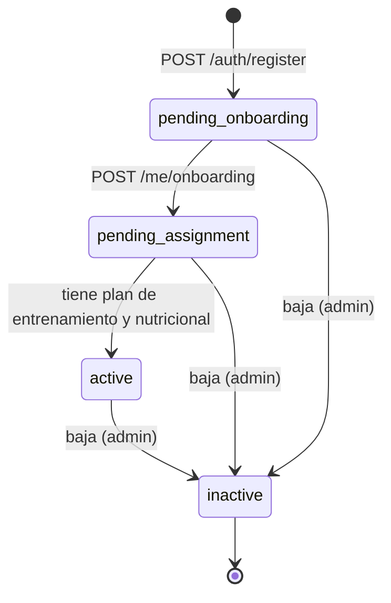

Los usuarios del personal (admin, entrenador, nutricionista) están siempre en `active` o en `inactive`.

### Secuencia de entrenamientos

Cada plan asignado tiene una fila `UserPlanWorkout` por entrenamiento del plan. Solo puede hacerse el primer
entrenamiento no completado.

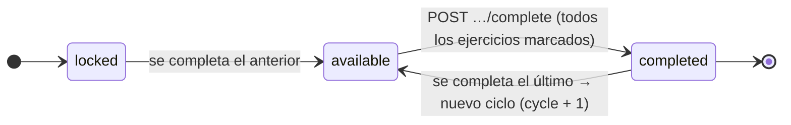

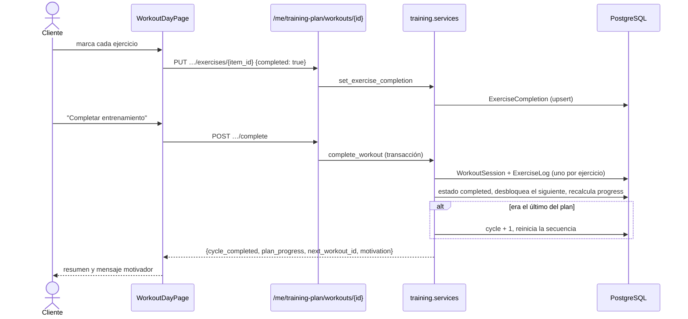

El calendario reparte los entrenamientos en los días elegidos por el cliente (`training_days`, editables desde
el plan semanal). Si no ha elegido ninguno, usa el reparto por defecto según `weekly_training_days`
(`apps/training/schedule.py`). La hora objetivo de la cuenta atrás es `DEFAULT_TRAINING_TIME`.

### Insignias

`apps/progress/badges.py` calcula ocho insignias a partir de las sesiones, los ciclos completados, los
registros de peso y el objetivo. Se guardan en `UserBadge` la primera vez que se cumple su condición y no se
retiran. Se evalúan al completar un entrenamiento y al registrar el peso (las respuestas incluyen
`new_badges`), y también al consultar `GET /me/badges`.

### Series, récords y adherencia

- Las series que el cliente anota viven en `ExerciseCompletion.sets` mientras el entrenamiento está abierto y
  pasan a `ExerciseSet` al completarlo. Los récords y el historial de cargas se calculan a partir de
  `ExerciseSet` (D-67).
- `apps/progress/adherence.py` compara los días entrenados con los programados por el calendario de cada
  cliente en 28 días y clasifica a los clientes en inactivos, en riesgo o al día (D-68).
- `apps/progress/stats.py` resume las últimas 12 semanas del cliente (sesiones, minutos y kilos levantados
  con `ExerciseSet`) y las series por grupo muscular de los últimos 28 días (`ExerciseLog`), en tres
  consultas. Alimenta los gráficos de Progreso → Entrenos.
- El panel (`GET /me/progress/dashboard`) añade la semana en curso y la racha: semanas seguidas del plan
  actual con todas las sesiones previstas hechas (una consulta más, hasta 52 semanas atrás).

### Contenido en tres idiomas

`apps/core/translation.py` resuelve los textos del catálogo en el idioma activo de la petición
(`LocaleMiddleware`), y en español si falta la traducción (D-76):
- `TranslatedMixin`, en los *serializers* del catálogo;
- `localized()` y `localized_value()`, en los servicios que construyen diccionarios;
- `TranslationsField`, para leer y escribir el JSON `translations`;
- `order_by_localized_name()`, para las listas.

En el frontend, `useResource` vuelve a pedir los datos al cambiar de idioma, y la sección «Traducciones» de
los formularios edita el inglés y el catalán.

### Notas, recordatorios y verificación del email

- `apps/notes`: un hilo por cliente con marca de lectura por lado (D-69).
- `apps/training/reminders.py` y el comando `send_training_reminders` (*cron* horario) envían un recordatorio
  al día como máximo, antes de la hora de entreno de cada cliente (D-70).
- Los textos de los emails (recuperación, confirmación y recordatorio) están en `apps/accounts/emails.py` en
  los tres idiomas. Se usa el idioma guardado en la cuenta o el de la petición (D-71).
- La confirmación del email usa un enlace firmado con caducidad (`apps/accounts/services.py`, D-72).

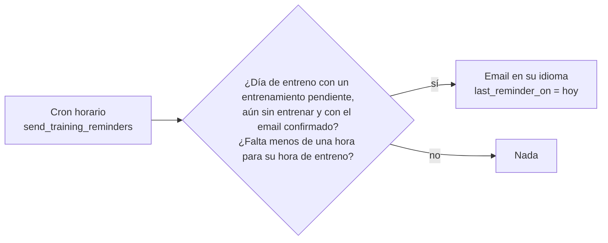

## 3. Frontend

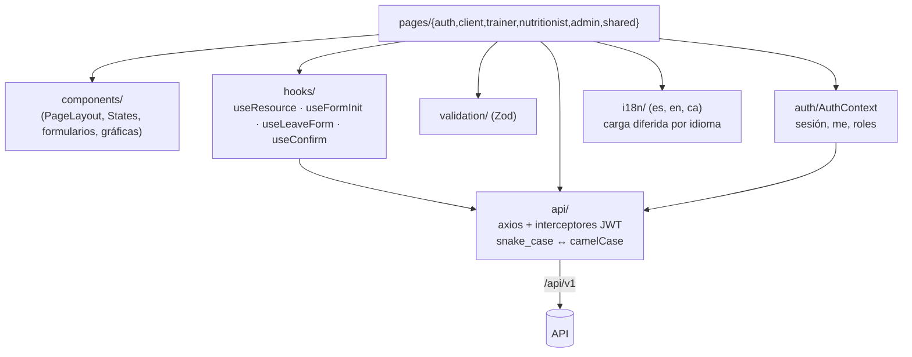

- **Capa `api/`.**
  - Es el único sitio que conoce la forma *snake_case* de la API.
  - Guarda el *access token* en memoria. El *refresh* es una cookie httpOnly que pone la API: JavaScript
    no la ve. En `localStorage` solo queda una marca de que hay una sesión que restaurar.
  - Todas las peticiones llevan `X-Requested-With: entrenanutricion` (defensa CSRF de la cookie).
  - Refresca el token una sola vez aunque fallen varias peticiones a la vez.
  - Traduce los errores a `ApiError` con `code` y `fieldCodes`.
- **Datos frescos.** `useResource` recarga al entrar en cada vista (`useIonViewWillEnter`) y descarta las
  respuestas obsoletas.
- **Carga por rol.** Las páginas de `/app` se importan dinámicamente (`layouts/appRoutes.ts`).
  `useRoleRoutes` carga a la vez las del rol del usuario antes de pintar las pestañas: cada rol descarga
  solo su código.
- **Sin conexión.**
  - `withOfflineCopy` guarda la última respuesta del plan, de los entrenamientos y de los ejercicios, por
    usuario, y la devuelve si no hay red.
  - Las marcas de «hecho» sin red esperan en una cola (`src/offline/outbox.ts`) que se envía con el evento
    `online`.
  - Las copias se borran al cerrar sesión.
- **Formularios.**
  - React Hook Form + Zod.
  - Los errores de campo del backend se pintan en el campo correspondiente mediante su clave con puntos.
- **i18n.** Ningún texto literal en los componentes. Los enums y los códigos de error se traducen por clave,
  y un test comprueba que los tres idiomas tienen las mismas claves.
- **Gráficos** (D-90).
  - `components/charts/` envuelve Chart.js, que se carga solo en las pantallas que lo usan: barras, líneas,
    donuts y las gráficas de peso, carga y macros. Todas leen los colores del tema, sirven para el modo claro y
    el oscuro y repiten sus valores en una tabla oculta para lectores de pantalla (`ChartTable`).
  - Sin Chart.js: `ProgressRing` (anillos en SVG), `StatTiles` (cifras con icono y tendencia) y
    `training/WeekStrip` (la semana de lunes a domingo).
- **PWA.**
  - `public/manifest.webmanifest`, iconos y `public/sw.js`, que solo se registra en producción.
  - El *service worker* sirve el *shell* de la app sin conexión y nunca cachea `/api`.

### Navegación por rol

El enrutado público lleva a cada usuario a su inicio según rol y estado (`src/auth/routing.ts`). Dentro de
`/app` solo se registran las rutas permitidas para ese usuario (`src/layouts/appRoutes.ts`); cualquier otra
ruta redirige a su inicio.

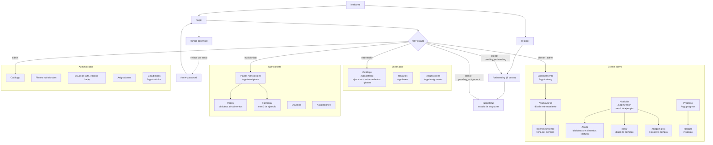

| Rol | Pestañas | Perfil (`/app/profile`) |
|---|---|---|
| Cliente pendiente | Estado · Perfil | Pestaña |
| Cliente activo | Entrenamiento · Nutrición · Progreso · Perfil | Pestaña |
| Entrenador | Catálogo · Usuarios · Asignaciones · Perfil | Pestaña |
| Nutricionista | Planes nutricionales · Usuarios · Asignaciones · Perfil | Pestaña |
| Administrador | Catálogo · Planes nutricionales · Usuarios · Asignaciones · Estadísticas | Avatar de la barra superior |

Los identificadores de las rutas solo aceptan dígitos (`:id(\d+)`), de modo que `/new` nunca se interpreta
como un detalle.

## 4. Seguridad

- **Contraseñas.** Hash Argon2. Política de longitud mínima, mayúscula, minúscula, dígito y símbolo, validada
  en el backend y en Zod.
- **Recuperación de contraseña.**
  - El enlace es de un solo uso y caduca (60 min por defecto).
  - La respuesta a la petición es siempre la misma, exista o no la cuenta.
  - Al restablecer la contraseña se cierran todas las sesiones.
- **Tokens JWT.**
  - El *access* dura 15 min y solo vive en memoria.
  - El *refresh* va en una cookie `HttpOnly`, `Secure` y `SameSite=Lax`, limitada a `/api/v1/auth/`.
  - El *refresh* rota y el anterior pasa a la *blacklist*. Dura 12 h, o 7 días con "Recordar sesión".
  - El *logout* y el cambio de contraseña invalidan los *refresh*.
  - En Render, la web sirve la API bajo su propio origen (*rewrite* `/api/*`), de modo que la cookie es de
    primera parte.
- **Content-Security-Policy** estricta: solo scripts propios, sin `eval` y sin marcos.
  - Se define en `frontend/security-headers.ts` y la sirven nginx, Render y `vite preview`.
  - Un E2E comprueba que el *build* de producción funciona bajo ella sin violaciones.
- **Límites de peticiones** en login, registro, cambio y recuperación de contraseña y comprobación de email.
  El cliente se identifica por la dirección que añade el *proxy* (`NUM_PROXIES`), nunca por la que dice ser.
- **Protección de datos.**
  - Consentimiento versionado de la política de privacidad y consentimiento expreso para los datos de salud.
  - Exportación de los datos y borrado de la cuenta por el propio cliente.
  - Purga de las cuentas dadas de baja.
- **Operación.** Monitorización con Sentry (sin datos personales) y copias diarias con restauración probada
  en la CI. Ver [`OPERATIONS.md`](OPERATIONS.md).
- **Permisos.**
  - Se comprueban siempre en el backend.
  - Un cliente solo accede a `/me/…`; un recurso ajeno responde 404.
- **Producción.**
  - `DEBUG=False`, HTTPS forzado, HSTS de un año, cookies seguras y `X-Frame-Options: DENY`.
  - `ALLOWED_HOSTS` y CORS son explícitos. `manage.py check --deploy` se ejecuta en la CI.
- **Ficheros.**
  - Se valida el tipo real del contenido, no la extensión, y el tamaño.
  - Los nombres son UUID.
  - El bucket es privado y se accede con URLs firmadas de corta duración.
- **Secretos** solo en variables de entorno; `.env` y las claves de GCS están en `.gitignore`.

## 5. Calidad y CI

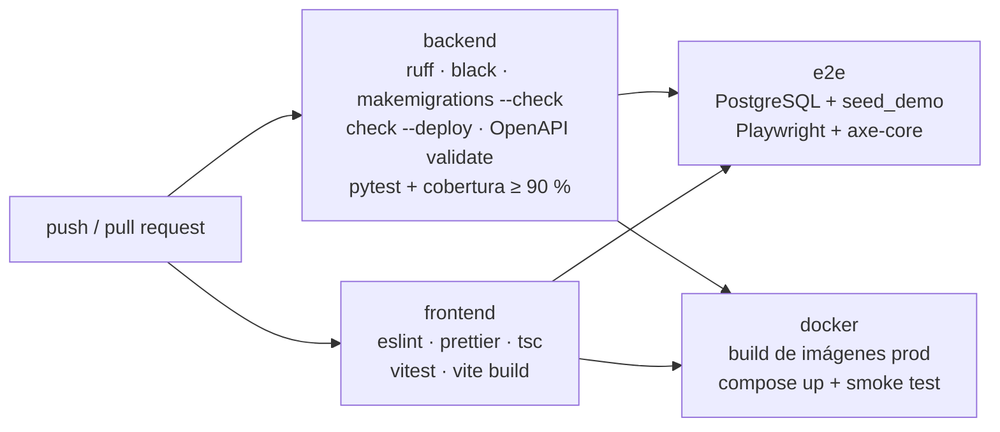
